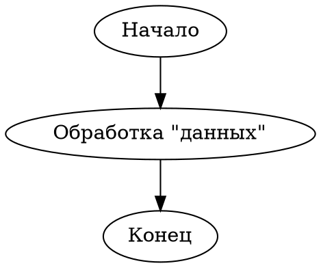

# 5.2. Преобразование JSON в Graphviz DOT

**Тема:** Конвертация данных из одного формата в другой

**Язык:** F#

**Ветка:** `5_task_2_fsharp`

## Постановка задачи

Прочитать JSON-файл с описанием ориентированного графа: массивом вершин `nodes` (поля `id` и `label`) и массивом рёбер `edges` (поля `from` и `to`). Сформировать текстовый файл в формате Graphviz DOT с конструкцией `digraph`, объявлениями вершин и рёбрами вида `A -> B`. Идентификаторы вершин состоят из латинских букв, цифр и подчёркивания и начинаются с буквы; текстовые метки заключаются в кавычки и экранируются. Для чтения JSON использовать стандартный `System.Text.Json`.

**Входные данные:** JSON-файл с массивами вершин `nodes` и ориентированных рёбер `edges`.

**Выходные данные:** текстовый DOT-файл с описанием ориентированного графа, объявлениями вершин, их метками и рёбрами.

## Компиляция и запуск

Из корневой папки репозитория:

Программа запускается через F# Interactive без отдельной предварительной компиляции:

```bash
dotnet fsi 5_convert/task_2_fsharp/main.fsx 5_convert/task_2_fsharp/example.json /tmp/nl_5_2_output.dot
```

Первый аргумент — путь к исходному JSON-файлу, второй — путь для сохранения результата в формате DOT.

## Пример работы

**Входные данные:** файл `5_convert/task_2_fsharp/example.json`, описывающий ориентированный граф из трёх вершин и двух рёбер:

```json
{
  "nodes": [
    {"id": "A", "label": "Начало"},
    {"id": "B", "label": "Обработка \"данных\""},
    {"id": "C", "label": "Конец"}
  ],
  "edges": [
    {"from": "A", "to": "B"},
    {"from": "B", "to": "C"}
  ]
}
```

**Результат:** файл `/tmp/nl_5_2_output.dot`:



При успешном выполнении программа сообщает:

```text
Готово: вершин: 3, рёбер: 2. Результат: /tmp/nl_5_2_output.dot
```

## Видеодемонстрация

https://disk.yandex.ru/i/xWgWehHJZ953Bw